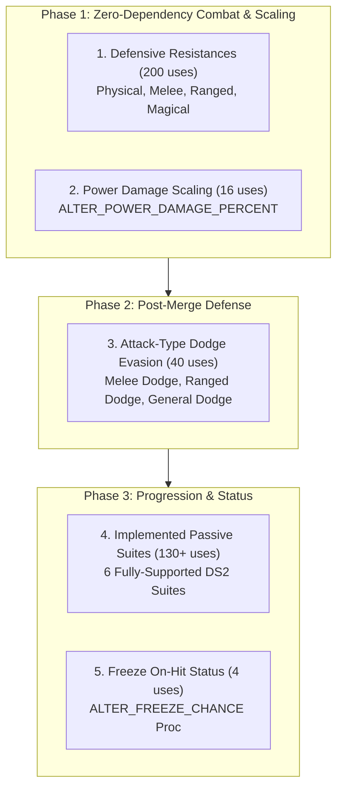

# Dungeon Siege II Equipment Alteration Implementation Roadmap

## 1. Executive Summary & Baseline Status

This roadmap defines the implementation path for all remaining Dungeon Siege II equipment alterations in Curse. It reconciles completed research, audits current gameplay consumer wiring, documents system dependencies, and establishes an evidence-based, prioritized implementation order.

### 1.1 Alteration Coverage Status Reconciled

Following the mechanical resolution of `alter_generic` across all 92 catalog occurrences, the 58 distinct DS2 equipment alterations are partitioned into the following verified states:

| Status | Count | Percentage | Definition & Scope |
| :--- | :--- | :--- | :--- |
| **`supported`** | **41** | 70.7% | Verified runtime consumers and active passing automated test suites on disk. |
| **`untested`** | **0** | 0.0% | 0 remaining. All previously untested implementations have verified automated tests. |
| **`unsupported`** | **16** | 27.6% | Identified source mechanics currently lacking runtime consumer pipelines in Curse. |
| **`unresolved`** | **0** | 0.0% | 0 remaining. `alter_generic` was the single unresolved alteration, now resolved. |
| **`cosmetic_only`** | **1** | 1.7% | `alter_generic` (88 weapon VFX hooks, 1 UI range tooltip dummy, 3 quest cipher clues). |
| **`excluded`** | **0** | 0.0% | No alterations are excluded (explicit exclusions apply only to game systems like durability). |
| **Total** | **58** | **100.0%** | Full zero-omission boundary over all 768 items, 304 affixes, and 27 sets. |

> [!NOTE]
> `alter_generic` is classified strictly as `cosmetic_only` rather than `supported` to preserve verification integrity. It does not inflate the supported gameplay count because it contributes zero combat stats or damage.

---

## 2. Current State: Loot vs. Combat Wiring Audit

A critical distinction exists between alterations that are merely parsed/tested versus those actively generating in procedural loot and resolving in live combat:

### 2.1 The 34 Live Supported Alterations

All 34 supported alterations are fully integrated across both loot generation and active combat resolution:

1. **Procedural Loot Spawning & Data:**
   - Authored in `data/affixes/*.tres` and loaded via `AffixDb.all()`.
   - Populated by `Items.build()`, `Items.roll_mods()`, and `ItemDb.all()`.
   - Tooltip formatting implemented in `AffixDb.describe_stat()` and `Items.lines()`.
   - Persisted cleanly in character save payloads via `Items.to_save()` and `Items.from_save()`.

2. **Runtime Combat Pipelines:**
   - **Attributes (3):** `str`, `dex`, `int` — scaled through `HeroAttributes` and `PlayerStats.refresh()`.
   - **Vitals & Pools (2):** `life`, `mana` — additive pool expansion with boundary clamping.
   - **Base Weapon Damage (6):** `melee_min`, `melee_max`, `melee_pct`, `ranged_min`, `ranged_max`, `ranged_pct` — evaluated in `weapon_base_range()`, `weapon_range()`, and `ranged_range()`.
   - **Elemental Damage (4):** `fire_added`, `ice_added`, `lightning_added`, `death_added` (with floor/ceiling spans) — resolved in `Combat.resolve()` with element typing.
   - **Defenses & Block (4):** `armor`, `armor_pct`, `block` (melee), `block_ranged` — resolved in `total_armor()`, `Combat.resolve()`, and actor block rolls.
   - **Resistances (8):** elemental (`fire_resist`, `ice_resist`, `lightning_resist`, `death_resist`) and broad (`physical_resist`, `melee_resist`, `ranged_resist`, `magical_resist`) — proportional mitigation in `Combat.resolve()`, capped at 80% for heroes (`Combat.RESIST_CAP`).
   - **On-Hit Sustain (4):** `life_steal`, `mana_steal`, `life_per_hit`, `mana_per_hit` — executed in `Player._steal_resources()`.
   - **Passive Regeneration (2):** `life_regen`, `mana_regen` — passive recovery acceleration in `PlayerStats.regen()`.
   - **Retaliation (1):** `reflect` — attacker damage reflection in `Player._on_received_hit()`.
   - **Magic Damage & Powers (2):** `spell_pct`, `recharge` — Combat Magic spell scaling in `spell_range()` and power threshold reduction in `power_recharge_damage()`.
   - **Utility & Drops (2):** `magic_find`, `gold_find` — party-averaged loot drop multipliers in `MonsterLoot` and `PartyManager.loot_bonuses()`.

### 2.2 The 16 Unsupported Alterations

The remaining 16 unsupported alterations are not wired into gameplay. The four broad defensive resistance alterations are now connected to procedural affixes, equipment aggregation, combat, and Item Lab; see [defensive resistance verification](DEFENSIVE_RESISTANCE_VERIFICATION.md).

---

## 3. Comprehensive Audit of the 16 Remaining Unsupported Alterations

Across the canonical DS2 catalog (`data/reference/ds2_equipment_catalog.json`), the 16 remaining unsupported alterations account for **485 total occurrences** across items, affixes, and set bonuses:

| Alteration Identifier | Category | Items | Affixes | Sets | Total | Values Span | Primary Target Pipeline |
| :--- | :--- | :---: | :---: | :---: | :---: | :--- | :--- |
| `alter_skill_suite` | Suite Bonus | 160 | 36 | 73 | **269** | +1 .. +4 ranks | `CharacterState.passive_ranks` / Tree |
| `alter_nmagic_damage_percent` | Multiplier | 33 | 8 | 7 | **48** | +4% .. +40% | `PlayerStats` (Nature Magic Damage) |
| `ALTER_MELEE_PASSIVE_SKILLS` | Passive Bonus | 14 | 2 | 26 | **42** | +1 .. +4 ranks | `CharacterState.passive_ranks` (Melee) |
| `ALTER_RANGED_PASSIVE_SKILLS` | Passive Bonus | 16 | 2 | 23 | **41** | +1 .. +4 ranks | `CharacterState.passive_ranks` (Ranged) |
| `ALTER_COMBAT_MAGIC_PASSIVE_SKILLS` | Passive Bonus | 14 | 2 | 12 | **28** | +1 .. +3 ranks | `CharacterState.passive_ranks` (Combat) |
| `ALTER_NATURE_MAGIC_PASSIVE_SKILLS` | Passive Bonus | 14 | 2 | 9 | **25** | +1 .. +3 ranks | `CharacterState.passive_ranks` (Nature) |
| `ALTER_POWER_DAMAGE_PERCENT` | Multiplier | 16 | 0 | 0 | **16** | +2% .. +50% | `powers.gd` / Power Damage Multiplier |
| `ALTER_FREEZE_CHANCE` | On-Hit Status | 4 | 0 | 0 | **4** | +1% .. +3% | `Combat.resolve()` / On-Hit Status Proc |
| `ALTER_DEBUFF_RESISTANCE` | Resistance | 3 | 0 | 0 | **3** | +5% | `Actor` / Debuff Duration Reduction |
| `ALTER_CHANCE_TO_DODGE_HIT_RANGED` | Evasion | 2 | 0 | 0 | **2** | +12% .. +25% | Alias for `alter_chance_to_dodge_hit_ranged` |
| `alter_melee_passive_skills` | Passive Bonus | 2 | 0 | 0 | **2** | +1 .. +3 ranks | Alias for `ALTER_MELEE_PASSIVE_SKILLS` |
| `alter_block_combat_magic_damage` | Defense | 1 | 0 | 0 | **1** | +6% | `Combat.resolve()` / Spell Mitigation |
| `alter_combat_magic` | Discipline | 1 | 0 | 0 | **1** | +1 level | `PlayerStats` (Combat Magic Level) |
| `alter_nature_magic` | Discipline | 1 | 0 | 0 | **1** | +1 level | `PlayerStats` (Nature Magic Level) |
| `ALTER_EXPERIENCE_GAINED` | Utility | 1 | 0 | 0 | **1** | +8% | `HeroProgression` / XP Gain Scalar |
| `ALTER_INTELLIGENCE` | Attribute | 1 | 0 | 0 | **1** | +25 | Alias for `alter_intelligence` |

---

## 4. Architectural Analysis & System Dependencies

### 4.1 Dependency Analysis: Passive Skills Gap

The largest group of unsupported alterations relates to passive skill rank bonuses (`alter_skill_suite`, discipline passive bonuses). DS2 defines **14 distinct skill suites** that grant bundled rank increases:

| Suite Identifier | Description / Included Passives | Present in Curse? |
| :--- | :--- | :---: |
| `melee_suite_1` | Barricade, Toughness, Reinforced Armor | **YES (3/3)** |
| `melee_suite_2` | Fortitude, Overbear, Smite | **YES (3/3)** |
| `melee_suite_3` | Critical Strike, Dual Wield, Alacrity | **PARTIAL (2/3)** — Missing `Dual Wield` |
| `ranged_suite_1` | Critical Shot, Dodge, Survival | **YES (3/3)** |
| `ranged_suite_2` | Biting Arrow, Far Shot, Shockwave | **PARTIAL (2/3)** — Missing `Shockwave` |
| `ranged_suite_3` | Quick Draw, Bleed, Penetrate | **YES (3/3)** |
| `cmagic_suite_1` | Debilitation, Grim Necromancy, Vampirism | **NO (0/3)** — Missing all 3 |
| `cmagic_suite_2` | Brilliance, Amplified Lightning, Arcing | **PARTIAL (1/3)** — Has `Brilliance` |
| `cmagic_suite_3` | Devastation, Searing Flames, Ignite | **YES (3/3)** |
| `nmagic_suite_1` | Summon Fortitude, Summon Might, Summon Bond | **NO (0/3)** — Nature Magic unported |
| `nmagic_suite_2` | Aquatic Affinity, Arctic Mastery, Freezing | **NO (0/3)** — Nature Magic unported |
| `nmagic_suite_3` | Nurturing Gift, Enveloping Embrace, Feral Wrath | **NO (0/3)** — Nature Magic unported |
| `special_suite_1` | Summon Alacrity, Quickened Casting | **PARTIAL (1/2)** — Has `Quickened Casting` |
| `special_suite_2` | Fortitude, Toughness | **YES (2/2)** |

#### Key Finding:
- **6 of the 14 suites** (`melee_suite_1`, `melee_suite_2`, `ranged_suite_1`, `ranged_suite_3`, `cmagic_suite_3`, `special_suite_2`) consist entirely of passive skills that **already exist in Curse**.
- These 6 suites account for over **130 equipment occurrences** and can be implemented immediately without waiting for missing passives to be authored.

### 4.2 Dependency Analysis: Dodge & Block Integration

- Claude is actively developing the unified block/dodge resolution in branch `agents/claude-dodge-block`.
- `alter_chance_to_dodge_hit_melee`, `alter_chance_to_dodge_hit_ranged`, and `alter_chance_to_dodge_hit` should be mapped directly into gear stats (`dodge_melee`, `dodge_ranged`, `dodge_all`) once Claude's core PR merges, avoiding parallel modifications to `game/combat.gd`.

### 4.3 Dependency Analysis: Nature Magic Discipline

- `alter_nmagic_damage_percent` (48 occurrences), `alter_nature_magic` (1 occurrence), and `ALTER_NATURE_MAGIC_PASSIVE_SKILLS` (25 occurrences) depend fundamentally on the authoring of the Nature Magic discipline (spells, summons, class progression tree).
- These 3 alterations must be deferred to the dedicated Nature Magic milestone.

---

## 5. Top Five Recommended Gameplay Implementations

Based on catalog occurrence count, player-facing gameplay impact, implementation complexity, and clean dependency boundaries:

---

### Priority 1: Physical, Melee, Ranged, and Magical Resistances — Implemented
- **Alterations:** `alter_physical_resistance`, `alter_melee_resistance`, `alter_ranged_resistance`, `alter_magical_resistance`
- **Scope & Frequency:** **200 occurrences** (129 items, 18 affixes, 53 set tiers).
- **Player-Facing Impact:** High. Shields, heavy plate, and defensive jewelry prominently feature physical and melee mitigation. Gives melee tanks survivability against swarm damage.
- **Complexity:** **Low**.
- **Implemented model:** approved additive overlap: physical + melee for melee hits; physical + ranged for ranged hits; magical + matching elemental resistance for typed magic. Each effective sum is capped once at the hero cap. Added weapon elements are reduced by their element resistance before the combined hit is reduced by melee/ranged resistance. Exact order and Curse-specific choices are recorded in [defensive resistance verification](DEFENSIVE_RESISTANCE_VERIFICATION.md).
- **Dependencies:** None. Self-contained in `PlayerStats` and `Combat`.

---

### Priority 2: Power Damage Scaling
- **Alterations:** `ALTER_POWER_DAMAGE_PERCENT`
- **Scope & Frequency:** **16 occurrences** (16 top-tier unique weapons, e.g. `ax_2h_unq_02` Earthshaker, `cb_unq_03` Arbalest of Might).
- **Player-Facing Impact:** Very High. Powers (Brutal Attack, Take Aim, Thunderous Shot) define high-impact combat moments. Wearing power-boosting uniques rewards power-heavy playstyles.
- **Complexity:** **Low**.
- **Implementation Strategy:**
  - Add runtime key: `power_pct` in `PlayerStats.gear`.
  - In `game/player/power_controller.gd` (or `powers.gd`), apply `(1.0 + player.stats.gear_stat("power_pct") / 100.0)` as a scalar to power base damage calculations.
  - Add card line in `AffixDb.describe_stat()`: `"+%d% Power damage"`.
- **Dependencies:** None. Powers pipeline already supports damage multipliers.

---

### Priority 3: Supported Passive Skill Suites (Phase 1)
- **Alterations:** `alter_skill_suite` (Restricted to the 6 suites with 100% Curse passive coverage)
- **Scope & Frequency:** **130+ occurrences** across crafted armors, uniques, and sets.
- **Suites Included:**
  - `melee_suite_1`: +Barricade, +Toughness, +Reinforced Armor
  - `melee_suite_2`: +Fortitude, +Overbear, +Smite
  - `ranged_suite_1`: +Critical Shot, +Dodge, +Survival
  - `ranged_suite_3`: +Quick Draw, +Bleed, +Penetrate
  - `cmagic_suite_3`: +Devastation, +Searing Flames, +Ignite
  - `special_suite_2`: +Fortitude, +Toughness
- **Player-Facing Impact:** Very High. Makes unique and crafted armor builds feel distinctly progression-oriented.
- **Complexity:** **Medium**.
- **Implementation Strategy:**
  - Add `suite_bonuses: Dictionary` to `CharacterState` or `PlayerStats` mapping individual passives to bonus ranks derived from equipped gear.
  - Update `CharacterState.get_effective_rank(passive_id)` to return `base_rank + gear_bonus`.
  - Format suite descriptions in `Items.lines()`.
- **Dependencies:** Passive skill tree queries; zero dependencies on missing passives.

---

### Priority 4: Attack-Type Gear Dodge Evasion
- **Alterations:** `alter_chance_to_dodge_hit_melee`, `alter_chance_to_dodge_hit_ranged`, `alter_chance_to_dodge_hit`, `ALTER_CHANCE_TO_DODGE_HIT_RANGED`
- **Scope & Frequency:** **40 occurrences** across 28 items and 10 set tiers (e.g. ranger leather armor, daggers, swift sets).
- **Player-Facing Impact:** High. Enables agile rogue/ranger evasion builds without relying purely on armor absorption.
- **Complexity:** **Low to Medium**.
- **Implementation Strategy:**
  - Add gear keys: `dodge_melee`, `dodge_ranged`, `dodge_all` to `PlayerStats.refresh()`.
  - Wire into `Actor.dodge_chance` and evaluate against incoming attack classification (`is_ranged` vs melee).
- **Dependencies:** Coordinate with Claude's unified block/dodge branch (`agents/claude-dodge-block`).

---

### Priority 5: On-Hit Freeze Status Effect
- **Alterations:** `ALTER_FREEZE_CHANCE`
- **Scope & Frequency:** **4 unique weapons** (e.g. `cb_dsx_ice_01` Frostbite Crossbow).
- **Player-Facing Impact:** Medium. Adds tactical crowd-control procs on frost weaponry.
- **Complexity:** **Medium**.
- **Implementation Strategy:**
  - In `Combat.resolve()`, roll `randf() < gear_stat("freeze_chance") / 100.0`.
  - If triggered, apply brief stun / 100% movement slow on victim via `Actor.apply_status("freeze", duration)`.
- **Dependencies:** Status effect duration / recovery mechanism on `Enemy` / `Actor`.

---

## 6. Implementation Phasing Strategy

| Milestone | Target Alterations | Key Deliverables | Risk / Dependencies |
| :--- | :--- | :--- | :--- |
| **Milestone 1** | `alter_physical_resistance`, `alter_melee_resistance`, `alter_ranged_resistance`, `alter_magical_resistance`, `ALTER_POWER_DAMAGE_PERCENT`, `ALTER_INTELLIGENCE` | Resistance mitigation in `Combat.resolve()`, power damage scalar in `powers.gd`, uppercase alias normalization. | **Zero**. Fully self-contained. |
| **Milestone 2** | `alter_chance_to_dodge_hit_melee`, `alter_chance_to_dodge_hit_ranged`, `alter_chance_to_dodge_hit`, `ALTER_CHANCE_TO_DODGE_HIT_RANGED` | Dodge evasion keys wired into `PlayerStats` and `Combat.resolve()`. | Depends on Claude's `agents/claude-dodge-block` merge. |
| **Milestone 3** | `alter_skill_suite` (6 supported suites), `ALTER_MELEE_PASSIVE_SKILLS`, `ALTER_RANGED_PASSIVE_SKILLS`, `ALTER_COMBAT_MAGIC_PASSIVE_SKILLS` | `CharacterState.get_effective_rank()` helper, equipment passive bonus aggregator, tooltip lines. | Medium complexity; requires UI/tooltip updates. |
| **Milestone 4** | `ALTER_FREEZE_CHANCE`, `ALTER_DEBUFF_RESISTANCE` | Freeze proc chance and debuff duration reduction. | Requires status effect duration handlers on actors. |
| **Milestone 5** | `alter_nmagic_damage_percent`, `alter_nature_magic`, `ALTER_NATURE_MAGIC_PASSIVE_SKILLS`, remaining 8 skill suites | Full Nature Magic discipline port and missing passive skill authoring. | Long-term roadmap dependency. |

---

## 7. Known Limitations & Integration Hazards

1. **Case-Sensitivity & Uppercase Gas Variants:**
   - Source GAS files contain inconsistent casing (e.g., `ALTER_MELEE_PASSIVE_SKILLS` vs `alter_melee_passive_skills`, `ALTER_INTELLIGENCE` vs `alter_intelligence`).
   - The engine affix loader must normalize alteration keys (`key.to_lower()`) during parsing while preserving exact manifest keys for validation tooling.
2. **Avoiding Merge Conflicts:**
   - Do not modify `game/combat.gd`'s block/dodge math until Claude's `agents/claude-dodge-block` PR merges into `main`.
   - Do not touch Codex's equipment requirements evaluator (`codex/ds2-equipment-requirements`).
3. **No Fabricated Proc Chances:**
   - As established by `docs/DS2_GENERIC_SCRIPT_RESEARCH.md`, unique weapons with `alter_generic` must never be given fabricated damage procs or spell-cast effects. They remain pure visual/audio profiles.
