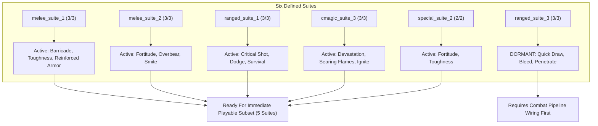
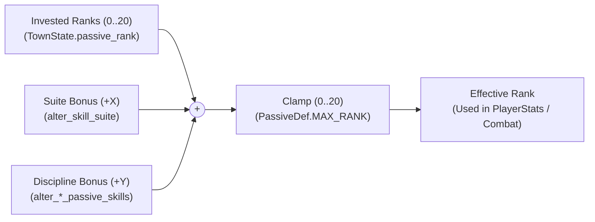

# Dungeon Siege II Passive Skill Suites & Discipline Alterations Research

**Author:** Gemini  
**Branch:** `agents/gemini-passive-suite-research`  
**Baseline Commit:** `6b6648512122d0c9d36ea6f67df34b5eaacd7549`  
**Reference Manifest:** `data/reference/ds2_effect_coverage_manifest.json`  
**Reference Inventory:** `data/reference/ds2_skill_suites.json`  
**Validation Tool:** `tools/check_ds2_skill_suites.py`  

---

## Executive Summary

This research establishes the complete mechanics, catalog distribution, runtime status, and implementation architecture for Dungeon Siege II equipment alterations that grant bonus ranks to passive skills.

In Dungeon Siege II, passive bonuses on equipment appear in two forms:
1. **Skill Suites (`alter_skill_suite`)**: Equipment granting bonus ranks to a thematic triplet or pair of passive skills (e.g., `melee_suite_1` granting `+X to Barricade, Toughness, and Reinforced Armor`).
2. **Discipline-Wide Passives (`alter_*_passive_skills` / `ALTER_*_PASSIVE_SKILLS`)**: Equipment granting bonus ranks to all passive skills within a specific combat discipline (Melee, Ranged, Combat Magic, or Nature Magic).

Across the entire DS2 equipment catalog (`data/reference/ds2_equipment_catalog.json`), there are exactly **407 occurrences** of these alterations:
- **`alter_skill_suite`**: **269 occurrences** across 14 distinct skill suites.
- **Discipline-wide passive alterations**: **138 occurrences** across 5 alteration tokens (including uppercase and lowercase variants).

Of the 14 skill suites defined in Dungeon Siege II:
- **6 suites** have all of their constituent skills authored as `.tres` definitions in Curse (`data/passives/`).
- **5 suites** have constituent skills that are **100% active and wired into live gameplay combat scaling** (`melee_suite_1`, `melee_suite_2`, `ranged_suite_1`, `cmagic_suite_3`, and `special_suite_2`).
- **1 suite** (`ranged_suite_3`: `quick_draw`, `bleed`, `penetrate`) has all definitions authored in `data/passives/`, but all three are currently **dormant** (no live combat consumers).
- **8 suites** contain skills that are partially or completely unported (notably all 3 Nature Magic suites, plus summons, lightning, death magic, and dual wield).

---

## Catalog Inventory & Alteration Breakdown

### 1. Alteration Token Occurrences

| Alteration Identifier | Normalized Token | Target Discipline | Items | Affixes | Set Tiers | Total Occurrences |
| :--- | :--- | :--- | :---: | :---: | :---: | :---: |
| `alter_skill_suite` | `alter_skill_suite` | Varies (14 suites) | 160 | 22 | 87 | **269** |
| `ALTER_MELEE_PASSIVE_SKILLS` | `alter_melee_passive_skills` | Melee | 14 | 8 | 20 | **42** |
| `alter_melee_passive_skills` | `alter_melee_passive_skills` | Melee | 2 | 0 | 0 | **2** |
| `ALTER_RANGED_PASSIVE_SKILLS` | `alter_ranged_passive_skills` | Ranged | 16 | 6 | 19 | **41** |
| `ALTER_COMBAT_MAGIC_PASSIVE_SKILLS` | `alter_combat_magic_passive_skills` | Combat Magic | 14 | 4 | 10 | **28** |
| `ALTER_NATURE_MAGIC_PASSIVE_SKILLS` | `alter_nature_magic_passive_skills` | Nature Magic | 14 | 4 | 7 | **25** |
| **Totals** | — | — | **220** | **44** | **143** | **407** |

> [!NOTE]
> `alter_melee_passive_skills` appears in lowercase on 2 unique weapons in DS2 GAS templates (`ax_1h_unq_02` / *Cleaver of Might* and `cb_unq_02` / *Heavy Crossbow of Might*), while all other occurrences are uppercase (`ALTER_MELEE_PASSIVE_SKILLS`). Runtime equipment processors must perform case-insensitive normalization.

---

## The 14 Dungeon Siege II Skill Suites

Every `alter_skill_suite` effect in DS2 specifies a `suite` string parameter corresponding to one of 14 canonical suites:

| Suite Identifier | Discipline | Constituent Skills | Curse Passive IDs | Curse Definition Status | Curse Gameplay Status | Catalog Uses |
| :--- | :--- | :--- | :--- | :--- | :--- | :---: |
| `melee_suite_1` | Melee | Barricade, Toughness, Reinforced Armor | `barricade`, `toughness`, `reinforced_armor` | **Fully Defined (3/3)** | **Fully Active (3/3)** | 27 |
| `melee_suite_2` | Melee | Fortitude, Overbear, Smite | `fortitude`, `overbear`, `smite` | **Fully Defined (3/3)** | **Fully Active (3/3)** | 35 |
| `melee_suite_3` | Melee | Critical Strike, Dual Wield, Alacrity | `critical_strike`, `null`, `alacrity` | Partially Defined (2/3) | Partially Active (2/3) | 26 |
| `ranged_suite_1` | Ranged | Critical Shot, Dodge, Survival | `critical_shot`, `dodge`, `survival` | **Fully Defined (3/3)** | **Fully Active (3/3)** | 26 |
| `ranged_suite_2` | Ranged | Biting Arrow, Far Shot, Shockwave | `biting_arrow`, `far_shot`, `null` | Partially Defined (2/3) | Partially Active (1/3) | 29 |
| `ranged_suite_3` | Ranged | Quick Draw, Bleed, Penetrate | `quick_draw`, `bleed`, `penetrate` | **Fully Defined (3/3)** | **Dormant (0/3)** | 28 |
| `cmagic_suite_1` | Combat Magic | Debilitation, Grim Necromancy, Vampirism | `null`, `null`, `null` | Unimplemented (0/3) | Inactive (0/3) | 18 |
| `cmagic_suite_2` | Combat Magic | Brilliance, Amplified Lightning, Arcing | `brilliance`, `null`, `null` | Partially Defined (1/3) | Partially Active (1/3) | 21 |
| `cmagic_suite_3` | Combat Magic | Devastation, Searing Flames, Ignite | `devastation`, `searing_flames`, `ignite` | **Fully Defined (3/3)** | **Fully Active (3/3)** | 21 |
| `nmagic_suite_1` | Nature Magic | Summon Fortitude, Summon Might, Summon Bond | `null`, `null`, `null` | Unimplemented (0/3) | Inactive (0/3) | 12 |
| `nmagic_suite_2` | Nature Magic | Aquatic Affinity, Arctic Mastery, Freezing | `null`, `null`, `null` | Unimplemented (0/3) | Inactive (0/3) | 10 |
| `nmagic_suite_3` | Nature Magic | Nurturing Gift, Enveloping Embrace, Feral Wrath | `null`, `null`, `null` | Unimplemented (0/3) | Inactive (0/3) | 5 |
| `special_suite_1` | Hybrid | Summon Alacrity, Quickened Casting | `null`, `quickened_casting` | Partially Defined (1/2) | Partially Active (1/2) | 6 |
| `special_suite_2` | Hybrid | Fortitude, Toughness | `fortitude`, `toughness` | **Fully Defined (2/2)** | **Fully Active (2/2)** | 5 |
| **Total** | — | — | — | **6 Fully Defined** | **5 Fully Active** | **269** |

---

## Detailed Audit: The Six Curse-Defined Suites

A critical distinction exists between an authored `.tres` definition in `data/passives/` and a passive skill whose rank actually influences player calculations in live combat.



### 1. `melee_suite_1` — Barricade, Toughness, Reinforced Armor (100% Active)
- **`barricade`**:
  - `PlayerStats.gd`: Scales `shield_defense_bonus` and `block_chance`.
  - Stance requirement: Checked when a shield is equipped.
- **`toughness`**:
  - `PlayerStats.gd`: Scales `damage_reduction` against physical damage (`toughness_pct = p_tough.value(r)`).
- **`reinforced_armor`**:
  - `PlayerStats.gd`: Scales total equipped armor value multiplier (`reinforced_pct = p_reinf.value(r)`).

### 2. `melee_suite_2` — Fortitude, Overbear, Smite (100% Active)
- **`fortitude`**:
  - `PlayerStats.gd`: Scales maximum hit points (`fortitude_pct = p_fort.value(r)`).
- **`overbear`**:
  - `PlayerStats.gd`: Scales two-handed melee weapon damage (`overbear_pct = p_over.value(r)`).
- **`smite`**:
  - `Player.gd` (`_deal_damage`): Proc chance to stun the target on hit (`smite_chance = p_smite.value(r)`).

### 3. `ranged_suite_1` — Critical Shot, Dodge, Survival (100% Active)
- **`critical_shot`**:
  - `PlayerStats.gd`: Adds critical hit chance to ranged attacks (`crit_chance_ranged = p_cshot.value(r)`).
- **`dodge`**:
  - `PlayerStats.gd`: Grants dodge chance against melee and ranged attacks (`dodge_chance = p_dodge.value(r)`).
- **`survival`**:
  - `PlayerStats.gd`: Increases all elemental and magical resistances (`survival_res = p_surv.value(r)`).

### 4. `cmagic_suite_3` — Devastation, Searing Flames, Ignite (100% Active)
- **`devastation`**:
  - `PlayerStats.gd`: Adds critical hit chance to combat magic spells (`crit_chance_spell = p_deva.value(r)`).
- **`searing_flames`**:
  - `PlayerStats.gd`: Grants percentage fire spell damage bonus (`fire_bonus = p_sflame.value(r)`).
- **`ignite`**:
  - `Player.gd` (`_deal_damage`): Proc chance on hit to apply burning damage-over-time (`ignite_chance = p_ignite.value(r)`).

### 5. `special_suite_2` — Fortitude, Toughness (100% Active)
- Shares constituent skills with `melee_suite_1` (`toughness`) and `melee_suite_2` (`fortitude`). Both are active in `PlayerStats.gd`.

### 6. `ranged_suite_3` — Quick Draw, Bleed, Penetrate (100% Defined, 0% Active)
- **`quick_draw`**: `.tres` exists, but bow attack rate and reload animation timers do not query `quick_draw`.
- **`bleed`**: `.tres` exists, but `Player.gd` contains no bleeding status effect or bleed DoT application on ranged hit.
- **`penetrate`**: `.tres` exists, but arrow projectiles do not pierce enemies.
- *Status:* Must be excluded from the initial playable subset until the projectile and status effect systems support these mechanics.

---

## Mechanics: Progression, Stacking, Caps & Unlocks

### 1. Effective Rank Formula
In Dungeon Siege II, equipment passive bonuses increase the **effective level** of the passive skill. The calculation is:

$$\text{effective\_rank} = \operatorname{clamp}(\text{invested\_rank} + \text{gear\_bonus}, 0, 20)$$



### 2. Rank Cap Behavior
- All 28 passive `.tres` definitions and original DS2 `.gas` curves define progression exclusively from `level_1` through `level_20`.
- In `PassiveDef.gd`:
  ```gdscript
  const MAX_RANK := 20
  
  func value(rank: int) -> float:
      if values.is_empty():
          return 0.0
      return values[clampi(rank - 1, 0, values.size() - 1)]
  ```
- Because the curve terminates at rank 20, any gear bonuses that push the total beyond 20 clamp cleanly at rank 20.
- Gear bonuses allow a character to achieve rank 20 performance while investing fewer skill points.

### 3. Interaction with Uninvested Skills (Rank 0)
- In DS2, equipping an item with `+X to <Skill/Suite>` allows the player to benefit from level $X$ of the passive even if the player has invested **0 skill points** into it.
- For example, a character with 0 points in `fortitude` equipping *Nightwolf Crest* (+1 to `melee_suite_2`) gains `fortitude` level 1 (+6% max HP).
- **Stance Requirements:** Stances like `overbear` (two-handed melee) and `barricade` (shields) check whether the stance passive rank is greater than 0. If gear grants +1 to `overbear`, a fighter can wield 2H weapons even without spending skill points.

### 4. Progression & Level Requirements
- In DS2, passive skills have hero level prerequisites for **spending skill points** (Tier 1: level 0, Tier 2: level 12, Tier 3: level 24, etc.).
- Gear bonuses **bypass hero level prerequisites**: a level 5 hero who equips an item granting `+2 to Devastation` (a Tier 3 passive) immediately gains level 2 Devastation critical strike chance.
- Gear bonuses **do not grant skill points** and **do not count towards the investment total** required to unlock higher tiers in the talent tree.

### 5. Stacking Rules
- Bonuses from multiple equipped items stack **additively**.
  - Example: Helmet granting `+2 to melee_suite_1` and Ring granting `+1 to melee_suite_1` provide `+3` to Barricade, Toughness, and Reinforced Armor.
- Discipline-wide passive alterations stack **additively** with skill suite alterations.
  - Example: Helmet granting `+2 to melee_suite_1` and Body Armor granting `+1 to Melee Skills` result in `+3` to Barricade, Toughness, and Reinforced Armor, and `+1` to all other melee passives.

---

## Architectural Implementation Design (Phase 1 Playable Subset)

### 1. Data Structures & Normalization

In `ItemGenerator.gd` / `TownState.gd` / `CharacterState.gd`:
```gdscript
# Canonical mapping of all 14 DS2 skill suites to Curse passive IDs
const SUITE_PASSIVES := {
    "melee_suite_1": ["barricade", "toughness", "reinforced_armor"],
    "melee_suite_2": ["fortitude", "overbear", "smite"],
    "melee_suite_3": ["critical_strike", "alacrity"],
    "ranged_suite_1": ["critical_shot", "dodge", "survival"],
    "ranged_suite_2": ["biting_arrow", "far_shot"],
    "ranged_suite_3": ["quick_draw", "bleed", "penetrate"],
    "cmagic_suite_2": ["brilliance"],
    "cmagic_suite_3": ["devastation", "searing_flames", "ignite"],
    "special_suite_1": ["quickened_casting"],
    "special_suite_2": ["fortitude", "toughness"],
}

# Discipline-wide alteration mapping (case-normalized)
const DISCIPLINE_PASSIVE_ALTERATIONS := {
    "alter_melee_passive_skills": "melee",
    "alter_ranged_passive_skills": "ranged",
    "alter_combat_magic_passive_skills": "combat_magic",
    "alter_nature_magic_passive_skills": "nature_magic",
}
```

### 2. Aggregating Gear Passive Bonuses
In `TownState.gd` (or `CharacterState.gd`):
```gdscript
func get_gear_passive_bonus(member_id: String, passive_id: String) -> int:
    var total_bonus := 0
    var p_def = get_passive_def(passive_id)
    if not p_def:
        return 0
    var discipline = p_def.tree  # "melee", "ranged", "combat_magic"
    
    var equipped = get_equipped_items(member_id)
    for item in equipped:
        for eff in item.get("effects", []):
            var alt = str(eff.get("alteration", "")).to_lower()
            if alt == "alter_skill_suite":
                var sid = str(eff.get("suite", ""))
                if sid in SUITE_PASSIVES and passive_id in SUITE_PASSIVES[sid]:
                    total_bonus += int(eff.get("value", 0))
            elif alt in DISCIPLINE_PASSIVE_ALTERATIONS:
                if DISCIPLINE_PASSIVE_ALTERATIONS[alt] == discipline:
                    total_bonus += int(eff.get("value", 0))
    return total_bonus

func effective_passive_rank(passive_id: String, member_id: String) -> int:
    var invested = passive_rank(passive_id, {}, member_id)
    var gear_bonus = get_gear_passive_bonus(member_id, passive_id)
    return clampi(invested + gear_bonus, 0, 20)
```

### 3. Pipeline Integration in `PlayerStats.gd`
In `PlayerStats.gd`, replace raw calls to `TownState.passive_rank(id)` with `TownState.effective_passive_rank(id)`:
```gdscript
func _get_effective_rank(passive_id: String) -> int:
    var p = _get_player()
    if p and not p.member_id.is_empty():
        return TownState.effective_passive_rank(passive_id, p.member_id)
    return TownState.passive_rank(passive_id)
```

### 4. Item Display & Tooltips (`Items.gd`)
Format descriptions in `Items.gd` `lines()`:
- `alter_skill_suite`: Extract and display the source description template (e.g. `"+%d to Barricade, Toughness, and Reinforced Armor" % value`).
- `alter_*_passive_skills`: Display `"+%d to %s Skills" % [value, discipline_name]`.

---

## Two Representative Source-Accurate Equipment Items for Testing

The following two items from `data/reference/ds2_equipment_catalog.json` provide ideal test coverage for the first playable subset:

### Item 1: `amr_hlm_ftr_mythril_unq` — "Helm of Glory"
- **Item ID:** `amr_hlm_ftr_mythril_unq`
- **Slot:** `es_head` (Fighter Helmet)
- **Source File:** `amr_helm_fighter.gas`
- **Item Level:** 81.0
- **Target Alteration:** `alter_skill_suite`
- **Suite:** `melee_suite_1`
- **Value:** `2`
- **Source Description:** `"+2 to Barricade, Toughness, and Reinforced Armor"`
- **Why this item is ideal:**
  - Affects three passives that are all 100% implemented, active, and testable in `PlayerStats.gd`:
    - `barricade`: Increases shield defense percentage and block chance.
    - `toughness`: Increases physical damage resistance.
    - `reinforced_armor`: Increases armor percentage.
  - Allows clean numerical verification before and after equipping.

### Item 2: `amr_glv_ftr_plate_unq` — "Noblegrip"
- **Item ID:** `amr_glv_ftr_plate_unq`
- **Slot:** `es_forearms` (Plate Gauntlets)
- **Source File:** `amr_gloves_fighter.gas`
- **Item Level:** 36.0
- **Target Alteration:** `alter_melee_passive_skills` (lowercase in source GAS)
- **Value:** `1`
- **Source Description:** `"+1 to Melee Skills"`
- **Why this item is ideal:**
  - Directly tests lowercase alteration identifier parsing (`alter_melee_passive_skills`) alongside uppercase handling.
  - Tests discipline-wide bonus application across all 8 Melee passives (`fortitude`, `overbear`, `smite`, `toughness`, `barricade`, `reinforced_armor`, `critical_strike`, `alacrity`).
  - Stacks additively with *Helm of Glory* on `barricade`, `toughness`, and `reinforced_armor` (yielding +3 total), providing an end-to-end stacking verification case.

---

## Unimplemented Dependencies Roadmap

| Dependency | Affected Suites / Alterations | Current Status | Blocker Description |
| :--- | :--- | :--- | :--- |
| **Nature Magic Discipline** | `nmagic_suite_1`, `nmagic_suite_2`, `nmagic_suite_3`, `ALTER_NATURE_MAGIC_PASSIVE_SKILLS` | Unimplemented (0 passives, 0 spells) | Requires porting the Nature Magic tree, healing/buff spells, and summon system. |
| **Death Magic & Curse Trees** | `cmagic_suite_1` | Unimplemented (0/3 passives) | Missing `debilitation`, `grim_necromancy`, `vampirism`. |
| **Lightning Specialization** | `cmagic_suite_2` | Partially Implemented (1/3 passives) | Missing `amplified_lightning` and `arcing` chain mechanics. |
| **Summon Mechanics** | `special_suite_1`, `nmagic_suite_1` | Partially Implemented (1/2 passives) | Missing `summon_alacrity`, `summon_fortitude`, `summon_might`, `summon_bond`. |
| **Dual Wielding** | `melee_suite_3` | Partially Implemented (2/3 passives) | Missing `dual_wield` weapon handling in combat. |
| **Arrow Piercing & Statuses** | `ranged_suite_3`, `ranged_suite_2` | Defined but Dormant (3 passives) | Missing arrow attack speed hook (`quick_draw`), bleed DoT (`bleed`), projectile piercing (`penetrate`), and arrow range scaling (`far_shot`). |

---

## Verification & Integrity

The reference data and catalog metrics have been verified using automated tooling:
- `tools/check_ds2_skill_suites.py`: Confirms 100% accuracy of all 407 alteration occurrences, 14 suites, 6 defined suites, 5 active suites, and 1 dormant suite.
- `tools/check_ds2_effect_coverage.py`: Confirms the integrity of the effect coverage manifest.
- Zero modifications were made to combat, player, powers, or equipment aggregation code during this research phase.
