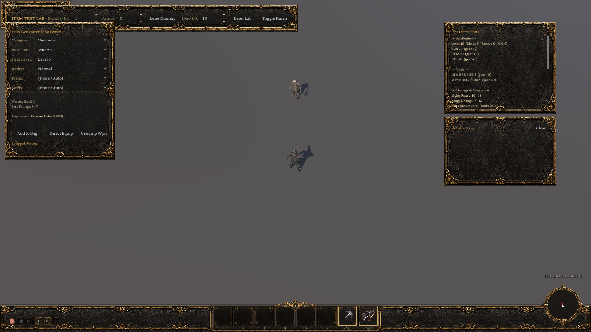
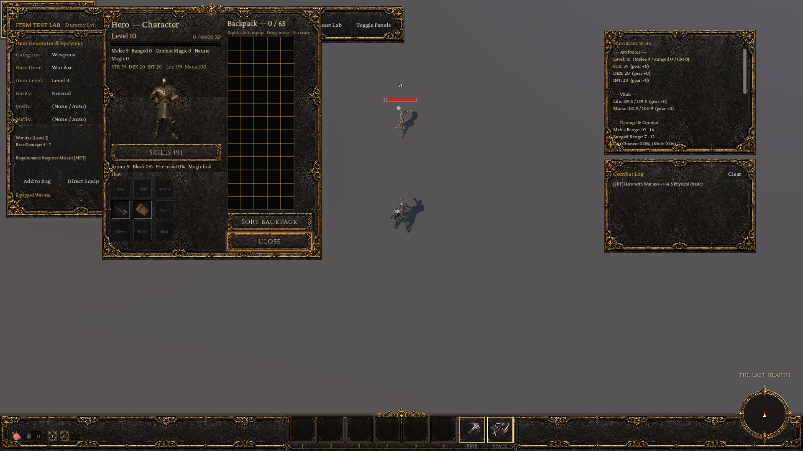
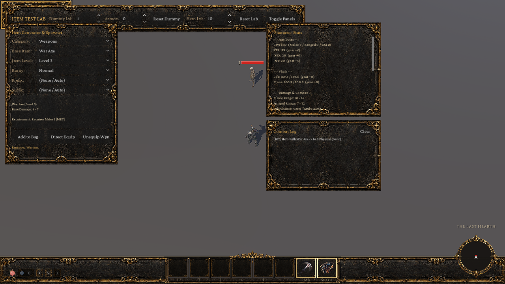

# Item Test Lab Verification (Phase 1)

## Overview

The **Item Test Lab** is a dedicated developer-only test environment inside Curse designed to test actual item, equipment, character visualization, and combat systems directly in Godot 4.8-dev2 without progressing through normal game states or risking production player saves.

All equipment rules, affix calculations, character model mounting, stance resolutions, and combat calculations use genuine gameplay systems rather than mock or simulated pipelines.

---

## Launch Instructions

### 1. Windows / Godot 4.8-dev2 Launch Commands

The Item Test Lab can be launched in multiple ways:

#### A. Main Menu CLI Flag
Launch through the standard menu entry point with the `--itemlab` developer argument:
```bat
Godot_v4.8-dev2_win64_console.exe --path . res://game/menu.tscn -- --itemlab
```

#### B. Direct Scene Launch
Launch the Item Test Lab scene directly:
```bat
Godot_v4.8-dev2_win64_console.exe --path . res://game/dev/item_lab/item_test_lab.tscn
```

#### C. Automated Screenshot Capture Runner
Run the built-in `--labshot` runner to capture multi-resolution screenshots at 1080p and 720p:
```bat
Godot_v4.8-dev2_win64_console.exe --path . res://game/dev/item_lab/item_test_lab.tscn --labshot
```

---

## Controls and Item Generation

The Item Test Lab interface is styled using the project's worn-gold ornate UI theme (`UiTheme.panel_box()`, `UiTheme.button()`).

### Spawner Panel (Left Side)
- **Category Filter**: Dropdown allowing filtering between:
  - *All Items*
  - *Weapons*
  - *Armor*
  - *Shields*
  - *Jewelry*
- **Base Item Selection**: Loads all 37 registered `ItemDef` resources, including the nine Wave 1 midgame bases: Chain Mail, Heater Shield, Dragon Helm, Carved Cap, Studded Gloves, Sorcerer Boots, Gold Ring, Jeweled Ring and Gold Amulet. Existing melee weapon examples include:
  - **War Axe** (`axe_1h`)
  - **Battle Axe** (`axe_2h`)
  - **Mace** (`mace`)
  - **Club** (`club`)
  - **Dagger** (`dagger`)
  - **Warhammer** (`hammer_2h`)
  - As well as Swords (`sword_1h`, `sword_2h`), Bows (`bow`), Shields (`buckler`, `heater`), Chest Armor, Helms, Boots, Gloves, Amulets, and Rings.
- **Item Level Variant**: Dynamically populates with valid levels defined in `ItemDef.levels` (e.g. Level 3, 15, 33, 52, 75).
- **Rarity Selection**: Supports `Normal`, `Magic`, `Rare`, and `Unique`.
- **Deterministic Affix Selection**: Allows explicit selection of prefix and suffix modifiers from `AffixDb` (or `None / Auto` to roll standard affixes matching item level and rarity).
- **Equip Requirement Feedback**: Evaluates `Items.hero_can_wear(item, player.member_id)` and displays exact requirements with live color feedback:
  - Displays `Requirement: Requires Melee X [MET]` or `[UNMET]` in real-time before equipping.
- **Action Buttons**:
  - `Add to Bag`: Instantiates the item and places it into the player's 65-slot backpack grid.
  - `Direct Equip`: Validates requirements and equips directly through `player.stats.equip(item, false)`. Rejection reasons (e.g., unmet discipline requirements) are displayed explicitly.
  - `Unequip Wpn`: Safely removes the currently equipped weapon.

### Top Bar Controls
- **Dummy Lvl** (SpinBox): Configures training dummy level (1 to 100), scaling baseline stats.
- **Dummy Armor** (SpinBox): Adjusts training dummy flat armor rating (0 to 1000).
- **Reset Dummy** (Button): Restores the dummy's health to maximum.
- **Hero Lvl** (SpinBox): Dynamically adjusts the hero level (1 to 100) via `TownState.dev_set_hero_level()`, updating attributes and equipping thresholds.
- **Reset Lab** (Button): Completely restores initial test state, resets dummy, clears test combat logs, and re-equips starting gear.
- **Toggle Panels** (Button): Hides/shows the spawner panel and stats readout for an unobstructed view of combat and inventory.

---

## Equipment & Character Visualization

- **Character Rig & Presentation**: Uses the actual `Player` node with the rigged knight model and skeleton (`CharacterPresentation.share_combat_clips(model)`).
- **Weapon Attachment**: Equipped weapons attach directly to the model's hand bones (`RightHand` / `LeftHand`) using `model.attach_weapon()`.
- **Stance & Slot Conflicts**:
  - Equipping a two-handed weapon (`axe_2h`, `hammer_2h`, `sword_2h`, `bow`) automatically unequips and displaces any worn shield into the bag (or inventory buffer).
  - Equipping a shield while wielding a two-handed weapon requires a 1H weapon.
- **Animation Pipeline**: Idle stances (`idle_alert`), movement blend trees, and attack animation clips execute through the production animation player.

---

## Live Equipment Statistics Readout (Right Side, Top)

The live stats readout panel immediately queries and displays effective runtime stats from `PlayerStats` and `Actor`:
- **Attributes**: Character Level, Discipline Levels (Melee, Ranged, Combat Magic), Strength, Dexterity, Intelligence (with separate gear bonus breakdown `gear +X`).
- **Vitals**: Maximum and current Life and Mana (with gear bonus breakdown).
- **Offense**:
  - Melee damage range (`stats.weapon_range(1.0)`)
  - Ranged damage range (`stats.ranged_range()`)
  - Critical strike chance (`player.crit_chance`) and critical multiplier (`player.crit_mult`)
  - Attack speed multiplier (`stats.attack_speed()`)
  - Added elemental fire damage (`player.added_fire` - `player.added_fire_max`)
- **Defenses**:
  - Total Armor (`player.armor`) with flat and percentage breakdown
  - Block Chance (`player.block_chance`)
  - Dodge Chance (`player.dodge_chance`)
  - Damage Reduction / Toughness (`player.damage_reduction`)
  - Fire Resistance (`player.fire_resistance`)
- **Sustain & Utility**:
  - Life Steal (`player.life_steal`) & Mana Steal (`player.mana_steal`)
  - Damage Reflection (`player.damage_reflection`)
  - Magic Find (`player.magic_find`) & Gold Find (`player.gold_find`)
- **Equipped Weapon Profile**: Displays weapon archetype and stance description.

---

## Training Dummy and Combat Testing

- **Training Dummy Actor**: `TrainingDummy` extends `Actor`, inheriting standard hurtbox, collision layers (`LAYER_ENEMY`), overlay flash materials, floating damage text, and health tracking.
- **Genuine Combat Resolution**: Attacks against the dummy execute through `Combat.resolve(attacker, defender, raw_damage, damage_type, is_crit, multiplier)` and apply damage through `Actor.receive()`.
- **Combat Log (Right Side, Bottom)**:
  - Listens to genuine `hit_received` events emitted by the dummy.
  - Logs timestamp, attacking character, equipped weapon, damage outcome (`HIT`, `CRIT`, `BLOCK`, `MISS`), damage type (`Physical`, `Fire`), final damage applied, and any life/mana leech restored to the player.
  - Clear button to wipe log history.
- **Dummy Durability**: The dummy absorbs all damage, plays hit flinch overlays, displays standard overhead floating damage numerals and health bars, and never dies permanently (retaining minimum health if lethal damage is dealt).

---

## Save Safety Safeguards

1. **Dedicated Developer Namespace**: The lab isolates all save operations under `user://dev_item_lab/`.
2. **Persistence Disabled**: `TownState.persist = false` is enforced upon initialization.
3. **SavePolicy Protection**: Under developer CLI arguments, `SavePolicy.is_dev_session()` returns `true` and `SavePolicy.may_modify(SavePolicy.PRODUCTION_PATH)` returns `false`.
4. **Zero Impact on Production Saves**: Production player save file `user://town.json` is never written to, modified, or deleted.

---

## Automated Verification

The test harness and specialized test suites verify all item and combat mechanics:

```bat
:: Item Lab focused suite
Godot_v4.8-dev2_win64_console.exe --headless --path . res://game/main.tscn -- --selftest --only=itemlab

:: Related mechanics suites
Godot_v4.8-dev2_win64_console.exe --headless --path . res://game/main.tscn -- --selftest --only=items
Godot_v4.8-dev2_win64_console.exe --headless --path . res://game/main.tscn -- --selftest --only=ds2items
Godot_v4.8-dev2_win64_console.exe --headless --path . res://game/main.tscn -- --selftest --only=rangedmods
Godot_v4.8-dev2_win64_console.exe --headless --path . res://game/main.tscn -- --selftest --only=equipmenthits
Godot_v4.8-dev2_win64_console.exe --headless --path . res://game/main.tscn -- --selftest --only=inventoryequip
Godot_v4.8-dev2_win64_console.exe --headless --path . res://game/main.tscn -- --selftest --only=weaponstyle
Godot_v4.8-dev2_win64_console.exe --headless --path . res://game/main.tscn -- --selftest --only=twohand
Godot_v4.8-dev2_win64_console.exe --headless --path . res://game/main.tscn -- --selftest --only=find

:: Full project self-test
Godot_v4.8-dev2_win64_console.exe --headless --path . res://game/main.tscn -- --selftest
```

### Test Suite Results Summary
| Suite | Result | Notes |
| :--- | :--- | :--- |
| `itemlab` | **PASS** | Tests lab instantiation, spawning weapon families, equipping, stat updates, dummy combat, combat log recording, unequip, and save isolation |
| `items` | **PASS** | Base catalog, affix generation, and equipment rolls |
| `ds2items` | **PASS** | DS2 item catalog mapping and baseline stats |
| `rangedmods` | **PASS** | Ranged weapon stat multipliers and damage calculations |
| `equipmenthits` | **PASS** | Genuine hit resolution with varied weapon equipment |
| `inventoryequip` | **PASS** | Bag-to-equipment transfers, swap logic, and requirement validation |
| `weaponstyle` | **PASS** | Stance logic (1H vs 2H, dual wield, weapon styles) |
| `twohand` | **PASS** | Two-handed weapon and shield displacement rules |
| `find` | **PASS** | Magic Find and Gold Find probability curves (100,000 samples) |
| Full `--selftest` | **PASS** | Complete multi-suite regression suite (all 35+ suites pass with exit code 0) |

---

## Visual Verification & Screenshots

In accordance with `CLAUDE.md` and `docs/UI_THEME.md`, the UI was captured and reviewed across 1080p and 720p desktop resolutions.

### 1. Lab Overview (1080p)

*Shows the Item Generator & Spawner on the left (Weapons filter, War Axe selected with level 3 variant and met Melee 1 requirement), player character model wielding the War Axe, training dummy, Live Stats Readout on top right, and empty Combat Log.*

### 2. Live Combat Testing (1080p)

*Shows genuine combat resolution: damage dealt to the training dummy, floating damage numeral ("14"), dummy health bar reduction, and the Combat Log recording `[HIT] Hero with War Axe -> 14.5 Physical (basic)`.*

### 3. Character Sheet & Equipment Bag (1080p)

*Shows standard HUD and Character Sheet integration (`hud._open_character()`) displaying the 3D paperdoll, equipped War Axe in the weapon slot, equipment slots, and backpack grid alongside the lab.*

### 4. Responsive 720p Layout (1280x720)

*Demonstrates responsive adaptation at 1280x720 resolution with panels docked cleanly without overlapping the central arena combat space.*

---

## Known Limitations (Phase 1 Scope)

1. **Roadmap Mechanics**: Only mechanics currently implemented in Curse runtime are displayed and tested. Unimplemented mechanics from the 42-category DS2 roadmap (e.g. cold/lightning resistances, active power scaling, set bonuses) are omitted until their respective phases.
2. **Crafting & Socketing**: Out of scope for Phase 1.
3. **Training Dummy Variety**: Uses a single configurable humanoid dummy with level/armor sliders rather than enemy pack director configurations.
